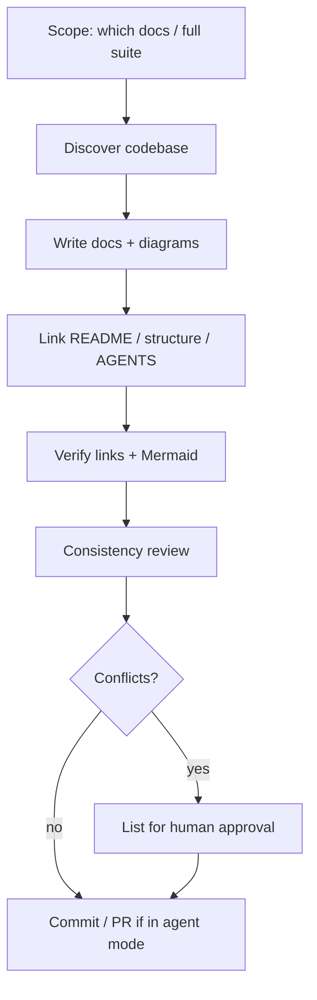

# Project documentation suite

Produce **real `.md` files in the repo** (not chat-only Markdown). Fill from the **current codebase**; mark unknowns **`[TBD]`**. Do **not** invent commands, endpoints, env vars, or stack versions.

## When to use

- User asks for PRD / system design / architecture / AI agent instructions / full docs package
- User wants docs refreshed after a major feature merge
- User asks to “document the project” for developers or coding agents

## Deliverables (create or update)

| # | Path | Purpose |
| --- | --- | --- |
| 1 | `docs/PRD.md` | Product requirements |
| 2 | `docs/SYSTEM_DESIGN_UIUX.md` | Design tokens, components, screens, a11y |
| 3 | `docs/SYSTEM_ARCHITECTURE.md` | Stack, components, data/API, security, deploy, ADRs |
| 4 | `docs/AI_AGENT_INSTRUCTIONS.md` | Agent SoT: workflow, commands, MUST/SHOULD/MUST NOT |
| 5 | `AGENTS.md` | Thin root entry pointing at #4 + priority docs |
| 6 | `docs/diagrams/*.mmd` | Reusable Mermaid sources (also embed in docs) |
| 7 | `docs/images/` | Placeholder for PNG/SVG exports (`.gitkeep` OK) |
| 8 | `docs/DOCUMENTATION_CONSISTENCY_REVIEW.md` | Cross-doc review (after 1–4 exist) |
| 9 | `README.md` / `docs/structure.md` | Links to the suite |

Section outlines and diagram list: [references/deliverables.md](references/deliverables.md).  
Quality / conflict rules: [references/quality-rules.md](references/quality-rules.md).

**Exemplar (this repo):** existing files under `docs/` and `AGENTS.md` — match tone and depth; do not blindly copy Desk-specific facts into other products.

## Workflow

### 1. Scope

- Default: **full suite** (1–7). Add consistency review (8) when ≥2 of PRD/UI/Arch/Agent exist.
- If user asks for one doc only, still read the others for alignment and link them.
- Ask only when product name, owner, or deploy target is unknowable from the repo.

### 2. Discover (read before write)

Gather from the repo (adapt paths):

| Need | Look for |
| --- | --- |
| Product / routes | README, app router, pages |
| Stack versions | `package.json`, `requirements*.txt`, Dockerfiles, Compose |
| Tokens / UI | global CSS / theme files, component classes |
| Data | schema SQL / migrations / models |
| API | routers, OpenAPI, MCP tool lists |
| Auth / security | session, OAuth, crypto modules |
| Deploy | `deploy/`, Compose, CI configs |
| Tests / commands | README, `pytest.ini`, npm scripts |

**Verify every command** against scripts/README. Put unverified commands as **`[TBD]`**.

### 3. Write documents

For each required file:

1. Use emoji section headings and tables (GitHub-compatible Markdown).
2. Prefer bullets over long paragraphs.
3. Embed Mermaid where useful; keep sources in `docs/diagrams/*.mmd` with relative links.
4. Label **Confirmed** vs **Proposal** vs **`[TBD]`**.
5. Fill from discovery — do not leave template placeholders like `[Technology]` when the stack is known.

**PRD:** features with IDs (FR-xxx), measurable AC where possible, NFRs, risks, UAT checklist.  
**UI/UX:** extract live design tokens (name, HEX, RGB, usage, a11y); map every route to a screen ID; document real components/classes.  
**Architecture:** components table, ERD, API map, ADRs for important choices, deploy topology.  
**Agent instructions:** doc priority order, verified command table, security MUST/MUST NOT, approval gates, thin `AGENTS.md` wrapper.

### 4. Link

- README: one line listing PRD, UI/UX, architecture, agent instructions (+ review if present).
- `docs/structure.md` (or equivalent): same links.
- `AGENTS.md`: point to `docs/AI_AGENT_INSTRUCTIONS.md` and priority reading order.

### 5. Verify

- Resolve every relative Markdown link from `docs/`.
- Mermaid: valid syntax; meaningful node labels; split oversized diagrams.
- Referenced assets under `docs/images/` exist or are clearly `[TBD]`.
- Design SoT: if a parallel design-system file conflicts with CSS, **flag for human approval** — do not silently pick (see quality-rules).

### 6. Consistency review

Produce `docs/DOCUMENTATION_CONSISTENCY_REVIEW.md` with:

- Executive summary
- Consistency matrix (Area × PRD × Design × Architecture × Agent × Status)
- Issue register (ID, severity, affected docs, recommended resolution)
- Recommended changes by document
- Final validation checklist (UI / backend / DB / integration / AI coding / test / deploy readiness)

**Do not silently resolve conflicting requirements.** List conflicts and wait for owner approval before patching.

### 7. After owner approval

Apply agreed resolutions across the affected docs, update the review’s “resolution status”, bump “Last updated”, commit.

## Formatting standards (mandatory)

- GitHub-compatible `.md`
- Emoji section identifiers in H2s
- Tables for tokens, FRs, components, commands
- Mermaid for architecture, flows, ERD, deploy, IA, agent workflow
- Relative paths only
- Concise bullets
- Collapsible `
` only when useful

## Anti-patterns

- Chat-only docs with no files written
- Invented npm/pip/docker commands
- Copying another product’s stack into a new repo
- Treating a generated `design-system/MASTER.md` as SoT when CSS differs
- Claiming tests/deploy passed without running them
- Auto-merging contradictory NFRs (e.g. “encrypted dump” vs plain `pg_dump`)

## Done checklist

- [ ] Requested docs exist under `docs/` (and `AGENTS.md` if agent doc created)
- [ ] Diagrams in `docs/diagrams/` + linked from docs
- [ ] README / structure linked
- [ ] Links and Mermaid verified
- [ ] Conflicts listed or resolved only after approval
- [ ] Summary for the user: paths created + open `[TBD]` / decisions

